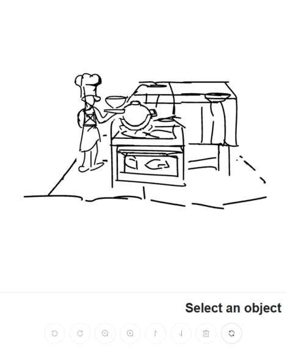
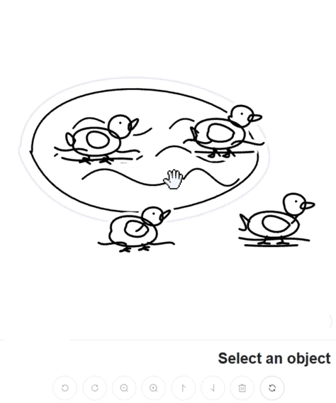
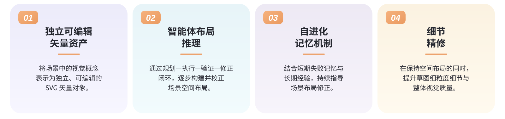
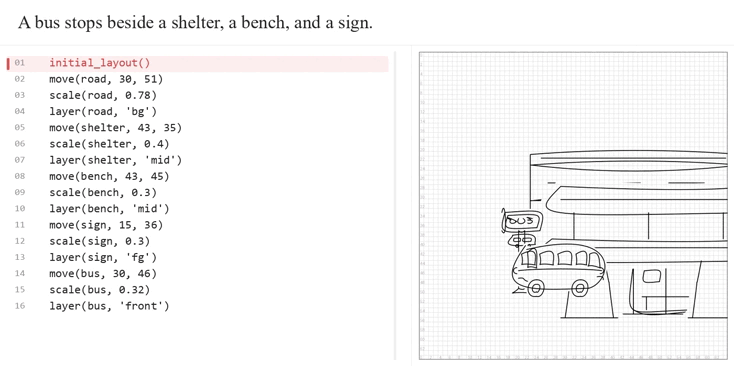
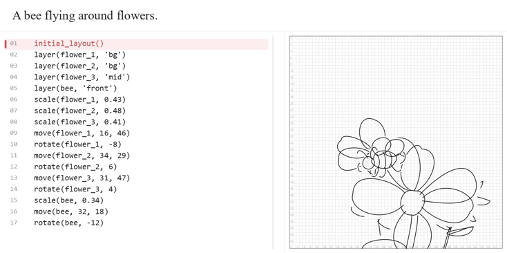

<div align="center">

<h1>
  
  SketchDirector
</h1>

<h3>基于智能体布局推理与细节优化的复杂场景草图生成</h3>
<p align="center">
  <strong>Yiqi Liang and Xiaodong Cun∗</strong>
  &nbsp;&nbsp;&nbsp; | &nbsp;&nbsp;&nbsp;
  GVC Lab, Great Bay University
</p>

<p align="center">
  <a href="https://arxiv.org/abs/2610.41260">
    
  </a>
  <a href="README.md">
    
  </a>
  <a href="README_zh.md">
    
  </a>
  <a href="https://yiki77.github.io/SketchDirector/">
    
  </a>
  <a href="https://huggingface.co/datasets/yiki77/MCSketch8K">
    
  </a>
  <br>
  
</p>
</div>
<p align="center">
  <a href="https://yiki77.github.io/SketchDirector/"></a>
  <a href="https://yiki77.github.io/SketchDirector/"></a>
  <a href="https://yiki77.github.io/SketchDirector/"></a>
</p>


## 💡 概述

**SketchDirector** 是一个面向**文本引导的多概念场景草图生成**的智能体框架。给定自然语言场景描述，SketchDirector 首先生成独立可编辑的对象级 SVG 草图资产，随后通过**智能体布局推理**将这些对象组织成空间关系合理的场景，最后利用**细节优化**增强草图细节。

不同于将整个场景视为不可拆分的单幅图像，SketchDirector 将场景表示为多个基于三次 Bézier 曲线的矢量对象，因此支持**对象级操作、可执行的布局调整，以及对象级和路径级编辑**。

<p align="center">
  
</p>


<h2>✨ Key Features</h2>

<p align="center">
  
</p>

## 📊 MCSketch8K 数据集

为支持**多概念场景草图生成与可控编辑**相关研究，我们构建了结构化数据集 **MCSketch8K**，包含 **1,000 个场景草图、超过 4,000 个独立可编辑的 SVG 对象资产，以及 800 多个对象类别**。

其中，1,000 条场景描述由大语言模型（LLM）生成。基于这些描述，我们利用 **SketchDirector** 构建数据集，生成对象级矢量资产、场景组合布局及对应的操作标注。MCSketch8K 为**对象级场景组合与空间布局推理**提供了结构化数据资源。

数据集已公开发布于 [Hugging Face](https://huggingface.co/datasets/yiki77/MCSketch8K)。


<p align="center">
  
  
</p>

## 🚀 环境安装

### 1. 克隆仓库

```bash
git clone https://github.com/Yiki77/SketchDirector.git
cd SketchDirector
```

### 2. 创建 Conda 环境

```bash
conda create -n sketchdirector python=3.9
conda activate sketchdirector
```

### 3. 安装依赖

```bash
pip install -r requirements.txt
```

安装 CUDA 11.8 对应的 PyTorch 版本：

```bash
pip install \
  torch==2.5.1+cu118 \
  torchvision==0.20.1+cu118 \
  torchaudio==2.5.1+cu118 \
  --index-url https://download.pytorch.org/whl/cu118
```

> 上述为 **CUDA 11.8** 配置。请根据实际 GPU、CUDA Toolkit 和系统环境确认兼容性；本说明未对当前仓库进行安装测试。

---

## 🎨 细节优化依赖

如果只需要运行对象资产生成和智能体布局推理，可以使用 `--skip_refinement`，并跳过本节。

### 安装 DiffVG

```bash
git clone https://github.com/BachiLi/diffvg.git
cd diffvg
git submodule update --init --recursive
python setup.py install
cd ..
```

### 安装优化阶段依赖

```bash
pip install -r requirements-refinement.txt
conda install -c conda-forge ffmpeg -y
```

---

## 🔑 API 配置

复制环境配置文件：

```bash
# Linux / macOS / Git Bash
cp .env.example .env
```

在 `.env` 中配置 API Key：

```dotenv
OPENAI_API_KEY=your_api_key
```

如果使用兼容 OpenAI 接口的服务，还可配置：

```dotenv
OPENAI_BASE_URL=your_api_base_url
```

---

## ▶️ 快速开始

### 单场景生成

```bash
python -m sketchdirector \
  --concept_to_draw "A ship moving on the wat" \
  --skip_refinement
```

`--skip_refinement` 表示仅运行对象资产生成与智能体布局推理，不运行扩散模型引导的细节优化。

### 批量生成

在 `examples/prompts.txt` 中按行填写场景描述，例如：

```text
A cat sleeping on a sofa.
A man reading a newspaper on a bench.
Two stone lions stand on either side of the temple steps.
```

执行：

```bash
python -m sketchdirector \
  --concept_file examples/prompts.txt \
  --skip_refinement
```

---

## ✨ 运行完整流程

运行包含细节优化的完整流程时，移除 `--skip_refinement`，并配置所需模型：

```bash
python -m sketchdirector \
  --concept_file examples/prompts.txt \
  --rf_model_path ./2_rectified_flow_from_sd_1_5 \
  --base_sd_model_path ./stable-diffusion-v1-5 \
  --tuned_model_path yykkL123/vector_style_sd1.5
```

The resulting sketches will be saved to the "output_sketches" folder, in SVG format.

**模型资源：**
| 模型名称 | 链接 |
| --- | --- |
| `Rectified Flow` | [模型链接](https://huggingface.co/XCLiu/2_rectified_flow_from_sd_1_5) |
| `Stable Diffusion v1.5` | [模型链接](https://huggingface.co/ruwnayml/stable-diffusion-v1-5) |
| `Vector Style SD1.5` | [模型链接](https://huggingface.co/yiki77/vector_style_sd1.5) |

**主要运行参数：**

| 参数 | 说明 |
| --- | --- |
| `--concept_to_draw` | 单个场景的文本描述 |
| `--concept_file` | 批量场景描述文本文件路径 |
| `--skip_refinement` | 跳过结构感知细节优化阶段 |
| `--rf_model_path` | Rectified Flow 模型路径 |
| `--base_sd_model_path` | Stable Diffusion 基础模型路径 |
| `--tuned_model_path` | 草图风格微调模型的本地路径或受支持的 Hugging Face 模型标识 |

---

## 🛠️ 常见问题（Troubleshooting）

### `pydiffvg` 安装失败

请检查 PyTorch、CUDA Toolkit、Python、C++ 编译器及相关依赖之间的兼容性，参考 [DiffVG 官方安装说明](https://github.com/BachiLi/diffvg#install)。

### API 请求失败

检查 `OPENAI_API_KEY`、`OPENAI_BASE_URL`、网络连接及当前 API 是否支持代码所使用的模型。

### 只运行布局推理，不执行细节优化

在运行命令中加入：

```text
--skip_refinement
```

即可跳过细节优化阶段及其附加模型需求。

---

## ⭐ 论文引用

如果 SketchDirector 对您的研究有所帮助，欢迎引用我们的工作。

```bibtex
@misc{liang2026sketchdirector,
  title={SketchDirector: Complex Scene Sketching via Agentic Layout Reasoning and Detail Refinement},
  author={Yiqi Liang and Xiaodong Cun},
  year={2026},
  eprint={2610.41260},
  archivePrefix={arXiv},
  primaryClass={cs.CV},
  url={https://arxiv.org/abs/2610.41260}
}
```
